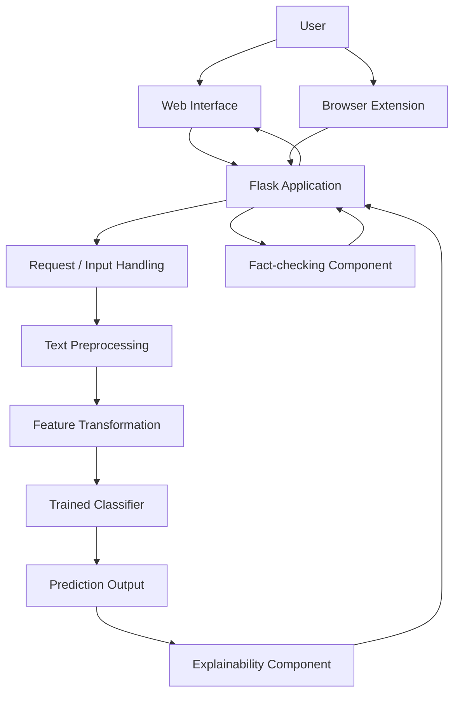
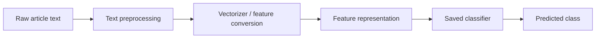
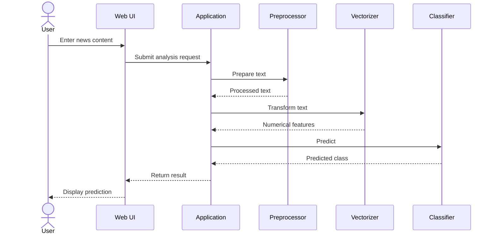
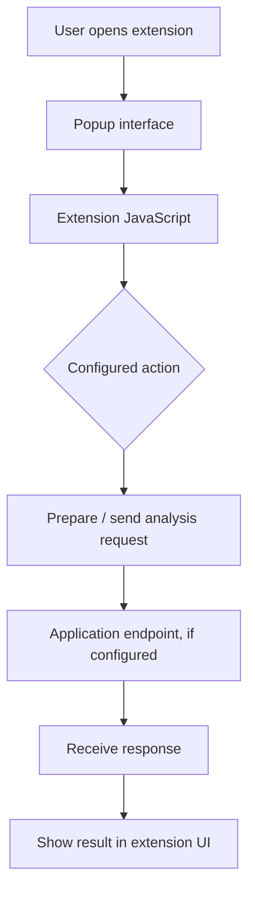

# VeriFact — AI-Powered Fake News Detection

📌 Overview
VeriFact is a news-analysis project built around Natural Language Processing (NLP) and Machine Learning. It explores how textual patterns in news content can be processed and used by a classification model to identify content that may be misleading.

The application brings together a web interface, text-processing and model components, prediction-related analysis, fact-checking functionality, and a browser-extension directory. The aim is to make machine-learning-based news analysis approachable through an interactive application instead of requiring users to work directly with the underlying model code.
Important: A model-generated label is a prediction—not proof that an article or claim is true or false. Always cross-check important claims with reliable sources.

🎯 Problem
Online information is easy to publish and distribute, but difficult to verify at scale. Misleading content can spread quickly, use persuasive language, omit context, or imitate credible news formats. Manually checking every article can be time-consuming.

VeriFact explores an automated text-classification approach that can help users examine news content and encourage more critical evaluation of information.
Goals
- Process unstructured news text using NLP techniques.
- Transform text into machine-readable features.
- Apply a trained classifier to produce a prediction.
- Provide an accessible interface for submitting content and viewing results.
- Explore explainability and supporting analysis.
- Include a browser-extension component for an additional access point.
- Keep model, application, and interface code organized into separate components.
✨ Features
Feature	Description
News classification	Predicts a class for submitted news text using the project's trained model.
Text preprocessing	Prepares input text for the model's feature-transformation and inference steps.
ML inference pipeline	Uses saved model artifacts to process input and generate a prediction.
Explainability module	Contains functionality for prediction-related explanations or analysis.
Fact-checking module	Includes a fact-checking-related component, subject to its configuration and supported integration.
Web application	Provides a browser-based interface for interacting with the project.
Browser extension	Includes extension files for browser-based interaction.
Docker configuration	Includes Docker and Compose files for containerized setup.

🧭 Application Workflow
The following diagram illustrates the high-level path from user input to result display.

🏛️ Architecture
VeriFact is organized around an application layer and machine-learning components. The Flask application handles web requests and connects user input to the model-side processing pipeline.

Main components
Component	Responsibility
Web interface	Collects input and presents application output.
Flask application	Application routing and request orchestration.
Preprocessing	Cleans and prepares text for inference.
Vectorizer	Converts text into the model's expected feature representation.
Model	Produces the classification prediction.
Explainability	Provides prediction-related analysis.
Fact-checking component	Supports the project's fact-checking-related functionality.
Browser extension	Offers a browser-side interface and supporting scripts.

🧠 NLP & Machine-Learning Pipeline
Text classifiers require numerical inputs. VeriFact's inference artifacts include a model file and a vectorizer file, which are intended to be used together with compatible preprocessing.

Pipeline stages
1. Input: News text is submitted through the application.
2. Preprocessing: The text is prepared using the project's preprocessing logic.
3. Feature conversion: The vectorizer transforms the processed text into numerical features.
4. Inference: The saved model receives the feature representation.
5. Prediction: The model returns its predicted class.
6. Result handling: The application formats and presents the output; additional analysis may be available through supporting modules.
Model-related files
File	Purpose
model/preprocess.py	Text preprocessing routines.
model/train_model.py	Model-training workflow.
model/train_bert.py	BERT/transformer-oriented training experimentation.
model/explain.py	Prediction explainability functionality.
model/factcheck.py	Fact-checking-related functionality.
model/model.pkl	Serialized classifier artifact.
model/vectorizer.pkl	Serialized text feature transformer.
model/metrics.json	Stored model metrics or evaluation information.

🔁 Prediction Sequence

🧩 Browser Extension
The repository also contains a browser-extension implementation. Its directory includes a manifest, background script, popup interface, popup JavaScript, and icons.
Extension file map
File	Role
browser-extension/manifest.json	Extension metadata and browser configuration.
browser-extension/background.js	Background extension logic.
browser-extension/popup.html	Popup UI structure.
browser-extension/popup.js	Popup interaction logic.
browser-extension/icons/	Icon assets.

Extension flow (conceptual)

The exact extension behavior depends on the implementation and its configuration. Review the extension scripts and manifest before describing it as automatically analyzing every webpage.
🛠️ Tech Stack
Technology	Use
Python	Application and ML-side development.
Flask	Web application framework.
NLP	Text processing and feature preparation.
Scikit-learn	Machine-learning tooling and classification pipeline components.
HTML / CSS	Web interface structure and styling.
JavaScript	Frontend and browser-extension behavior.
Docker	Containerization.
Docker Compose	Container configuration and orchestration.
Pytest	Test execution (development dependency).
Git / GitHub	Version control and source hosting.

📂 Project Structure
Fake-News-Detection-Using-NLP/
├── app.py                       # Main Flask application
├── make_admin.py                 # Administrative helper
├── test_app.py                   # Application tests
├── model/
│   ├── preprocess.py              # Text preprocessing
│   ├── factcheck.py               # Fact-checking-related logic
│   ├── explain.py                 # Explainability component
│   ├── train_model.py              # ML training pipeline
│   ├── train_bert.py               # Transformer experimentation
│   ├── model.pkl                   # Saved model
│   ├── vectorizer.pkl               # Saved vectorizer
│   └── metrics.json                 # Model metrics
├── browser-extension/
│   ├── manifest.json
│   ├── background.js
│   ├── popup.html
│   ├── popup.js
│   └── icons/
├── data/
│   ├── sample_data.csv
│   ├── generate_sample_data.py
│   └── README.md
├── templates/                       # HTML templates
├── static/                           # Static assets
├── .github/                           # GitHub configuration/workflows
├── Dockerfile
├── docker-compose.yml
├── requirements.txt
├── requirements-dev.txt
├── runtime.txt
├── Procfile
├── .env.example
├── .gitignore
├── LICENSE
└── README.md
🖥️ Screenshots
Add screenshots of the running application here. Replace these placeholders with real screenshots from your local app.

📷 Add your application screenshots
Home / Landing Page
<!-- Add screenshot:  -->
News Analysis Result
<!-- Add screenshot:  -->
Browser Extension
<!-- Add screenshot:  -->
🚀 Getting Started
Prerequisites
- Python installed and available on your PATH
- Git
- pip
- A modern web browser
- Docker (optional, for containerized execution)
1. Clone the repository
git clone https://github.com/AnushkaBharti2/Fake-News-Detection-Using-NLP.git
2. Enter the project directory
cd Fake-News-Detection-Using-NLP
3. Create a virtual environment
python -m venv venv
4. Activate it
Windows
venv\Scripts\activate
Linux / macOS
source venv/bin/activate
5. Install dependencies
pip install -r requirements.txt
6. Configure environment variables
Create a .env file in the project root based on .env.example. See Environment Configuration.
7. Run the application
python app.py
Open the local address printed in the terminal to access the web application.
⚙️ Environment Configuration
Use .env.example as a template and create a local .env file. Example:
SECRET_KEY=replace_with_a_random_secret
FACTCHECK_API_KEY=your_api_key_if_required
Variable	Description
SECRET_KEY	Application secret configuration. Set a unique, random value locally.
FACTCHECK_API_KEY	Credential for fact-check integration, if enabled/configured.

Do not commit .env files, tokens, or credentials. The repository's .gitignore should keep local secrets out of version control.
🌍 Running with Docker
Docker files are included for containerized execution.
docker compose up --build
To stop the containers:
docker compose down
Review the Docker and environment configuration before deployment. Some services may require local environment variables.
🧪 Testing
Install development requirements if needed:
pip install -r requirements-dev.txt
Run the test suite:
pytest
Use the test output to verify the implemented application behavior and identify regressions.
📊 Evaluation & Metrics
The repository includes a model/metrics.json file for stored metrics. When reporting model performance, use the values from that file and clearly state the dataset and evaluation method used.

Common classification metrics include:
Metric	Meaning
Accuracy	Overall fraction of correct predictions.
Precision	Fraction of predicted positives that are correct.
Recall	Fraction of actual positives identified.
F1-score	Harmonic mean of precision and recall.
Confusion matrix	Breakdown of correct and incorrect predictions by class.

Accuracy alone may not capture the risks of misinformation detection. Performance can vary across topics, sources, time periods, writing styles, and datasets.
🔒 Security & Responsible Use
- Store API keys and secrets in local environment variables, not source files.
- Keep dependencies reasonably up to date.
- Validate submitted content on the server.
- Avoid logging sensitive information unnecessarily.
- Review external integrations before deployment.
- Treat predictions as signals for further investigation—not definitive truth labels.
⚠️ Limitations
- Predictions are dependent on the training data and model design.
- Text alone may not provide enough context to verify a claim.
- The model may not generalize to new events, topics, or publishers.
- Legitimate content may be incorrectly flagged, and misleading content may be missed.
- Classification is not equivalent to source verification or independent fact-checking.
- External integrations may require credentials and additional configuration.
🗺️ Roadmap
- [ ] Capture and add polished application screenshots.
- [ ] Improve preprocessing and evaluate alternative feature representations.
- [ ] Benchmark additional classification models.
- [ ] Investigate transformer-based model approaches.
- [ ] Improve explainability and result transparency.
- [ ] Expand fact-checking sources and evidence presentation.
- [ ] Improve browser-extension user experience.
- [ ] Add more automated tests.
- [ ] Add CI checks for quality and reliability.
- [ ] Review deployment configuration for production use.
🤝 Contributions & Development
Ideas, bug reports, and improvements are welcome. Areas that can be explored include NLP, model evaluation, explainability, interface development, extension behavior, testing, documentation, and deployment.

Before proposing changes, review the existing project structure and license requirements.
📄 License & Attribution
This repository contains work based on an existing open-source project. The original license and attribution notices are retained. See the LICENSE file for details. Please preserve applicable attribution when redistributing or modifying the project.
⚖️ Disclaimer
VeriFact is an AI-assisted news analysis project intended for educational and research purposes. It cannot guarantee the truth or falsehood of a news article or claim. Model predictions can be wrong, biased, incomplete, or outdated. Verify important information using multiple credible sources and independent fact-checking.

  <strong>VeriFact — Analyze information. Think critically.</strong>

