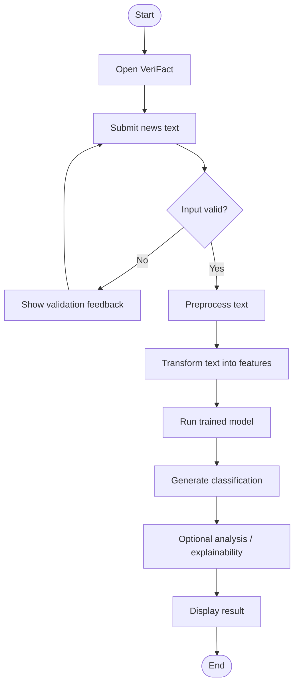
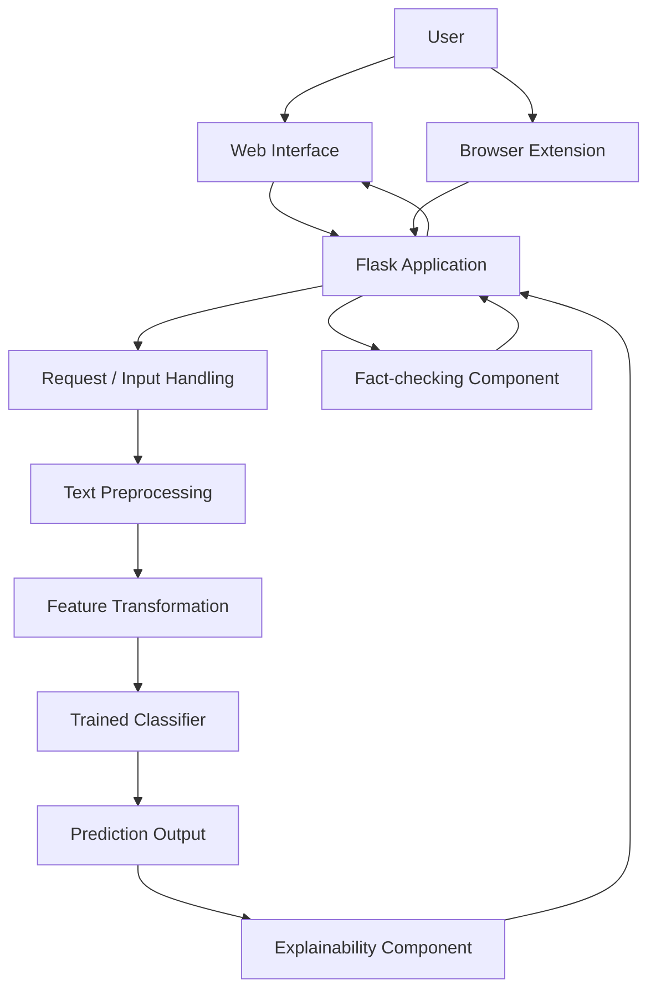
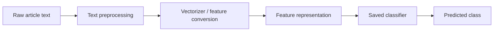
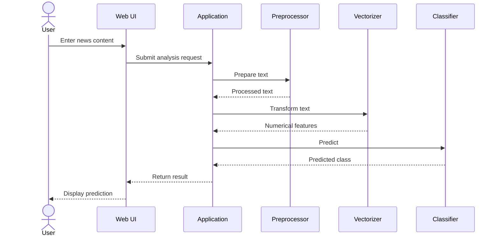
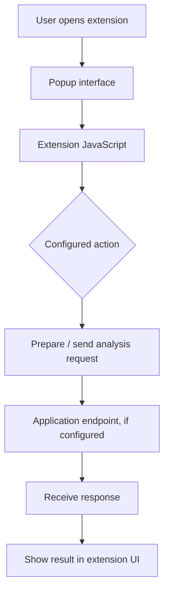
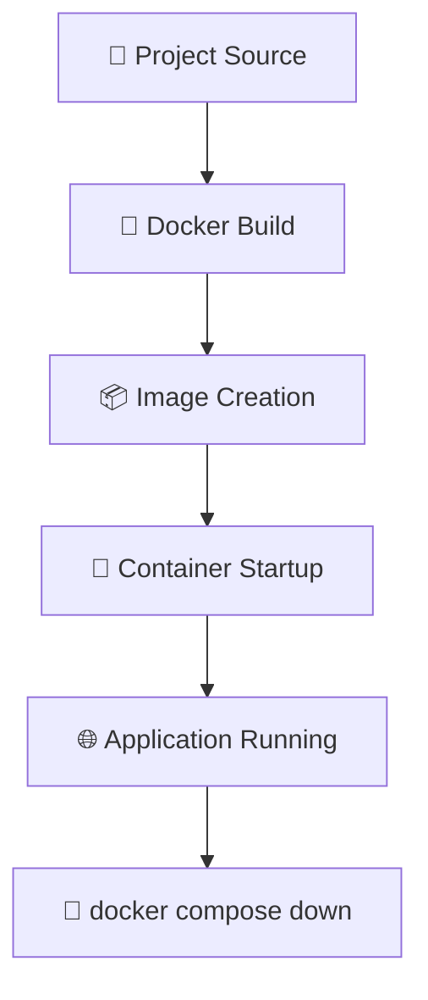
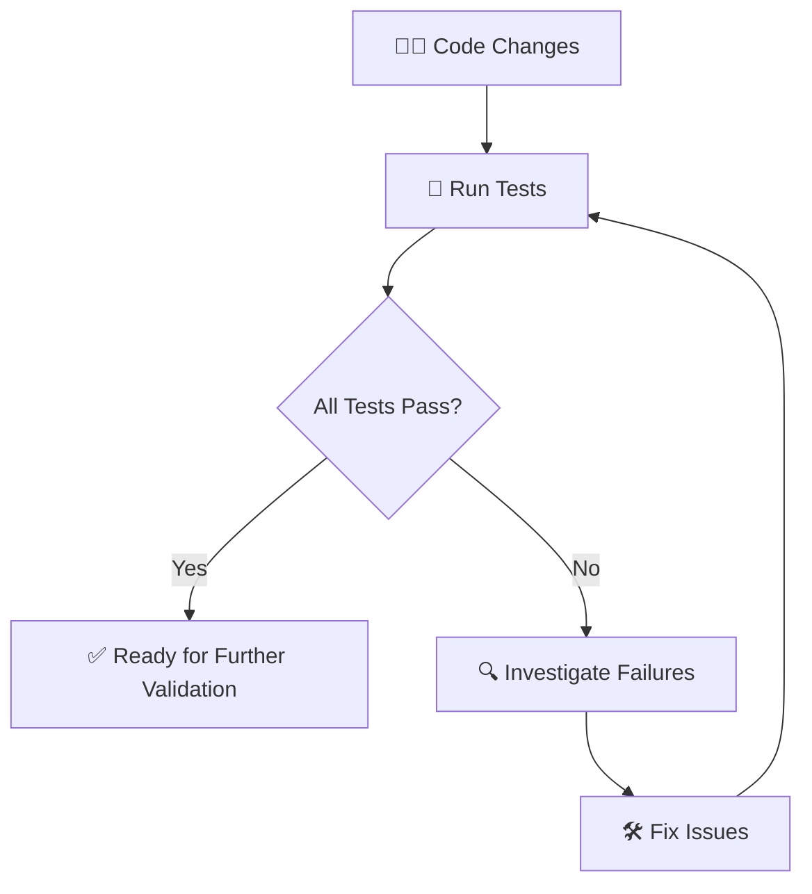
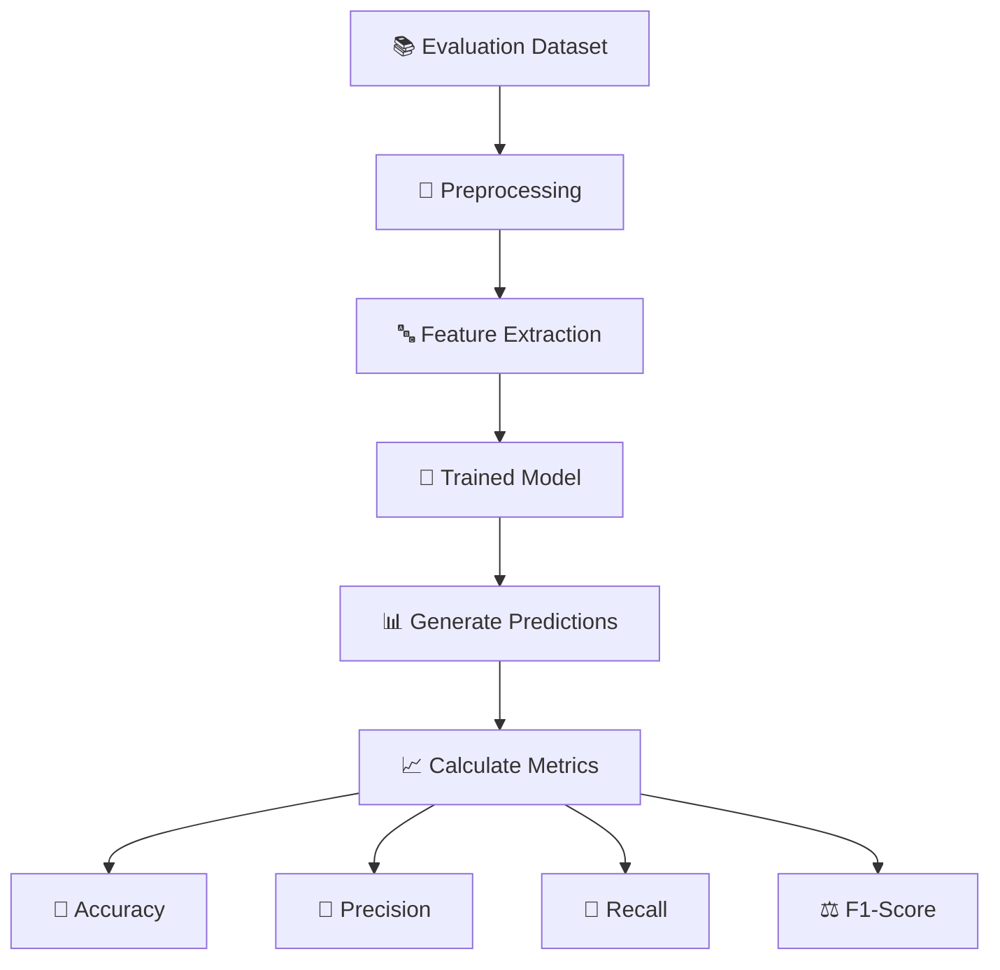

# VeriFact — AI-Powered Fake News Detection


# VeriFact — AI Fake News Detection

🌐 **Live Demo:**https://verifact-news-compass.lovable.app/

🔗 **GitHub Repository:** [View Source](https://github.com/AnushkaBharti2/Fake-News-Detection-Using-NLP)

> Explore the application through the live demo.
📌 Overview
VeriFact is a news-analysis project built around Natural Language Processing (NLP) and Machine Learning. It explores how textual patterns in news content can be processed and used by a classification model to identify content that may be misleading.

The application brings together a web interface, text-processing and model components, prediction-related analysis, fact-checking functionality, and a browser-extension directory. The aim is to make machine-learning-based news analysis approachable through an interactive application instead of requiring users to work directly with the underlying model code.
Important: A model-generated label is a prediction—not proof that an article or claim is true or false. Always cross-check important claims with reliable sources.

🎯 Problem
Online information is easy to publish and distribute, but difficult to verify at scale. Misleading content can spread quickly, use persuasive language, omit context, or imitate credible news formats. Manually checking every article can be time-consuming.

VeriFact explores an automated text-classification approach that can help users examine news content and encourage more critical evaluation of information.
Goals
- Process unstructured news text using NLP techniques.
- Transform text into machine-readable features.
- Apply a trained classifier to produce a prediction.
- Provide an accessible interface for submitting content and viewing results.
- Explore explainability and supporting analysis.
- Include a browser-extension component for an additional access point.
- Keep model, application, and interface code organized into separate components.
✨ Features
Feature	Description
News classification	Predicts a class for submitted news text using the project's trained model.
Text preprocessing	Prepares input text for the model's feature-transformation and inference steps.
ML inference pipeline	Uses saved model artifacts to process input and generate a prediction.
Explainability module	Contains functionality for prediction-related explanations or analysis.
Fact-checking module	Includes a fact-checking-related component, subject to its configuration and supported integration.
Web application	Provides a browser-based interface for interacting with the project.
Browser extension	Includes extension files for browser-based interaction.
Docker configuration	Includes Docker and Compose files for containerized setup.


🧭 Application Workflow
The following diagram illustrates the high-level path from user input to result display.

🏛️ Architecture
VeriFact is organized around an application layer and machine-learning components. The Flask application handles web requests and connects user input to the model-side processing pipeline.

Main components
Component	Responsibility
Web interface	Collects input and presents application output.
Flask application	Application routing and request orchestration.
Preprocessing	Cleans and prepares text for inference.
Vectorizer	Converts text into the model's expected feature representation.
Model	Produces the classification prediction.
Explainability	Provides prediction-related analysis.
Fact-checking component	Supports the project's fact-checking-related functionality.
Browser extension	Offers a browser-side interface and supporting scripts.


🧠 NLP & Machine-Learning Pipeline
Text classifiers require numerical inputs. VeriFact's inference artifacts include a model file and a vectorizer file, which are intended to be used together with compatible preprocessing.

Pipeline stages
1. Input: News text is submitted through the application.
2. Preprocessing: The text is prepared using the project's preprocessing logic.
3. Feature conversion: The vectorizer transforms the processed text into numerical features.
4. Inference: The saved model receives the feature representation.
5. Prediction: The model returns its predicted class.
6. Result handling: The application formats and presents the output; additional analysis may be available through supporting modules.
Model-related files
File	Purpose
model/preprocess.py	Text preprocessing routines.
model/train_model.py	Model-training workflow.
model/train_bert.py	BERT/transformer-oriented training experimentation.
model/explain.py	Prediction explainability functionality.
model/factcheck.py	Fact-checking-related functionality.
model/model.pkl	Serialized classifier artifact.
model/vectorizer.pkl	Serialized text feature transformer.
model/metrics.json	Stored model metrics or evaluation information.


🔁 Prediction Sequence

🧩 Browser Extension
The repository also contains a browser-extension implementation. Its directory includes a manifest, background script, popup interface, popup JavaScript, and icons.
Extension file map
File	Role
browser-extension/manifest.json	Extension metadata and browser configuration.
browser-extension/background.js	Background extension logic.
browser-extension/popup.html	Popup UI structure.
browser-extension/popup.js	Popup interaction logic.
browser-extension/icons/	Icon assets.


Extension flow (conceptual)

The exact extension behavior depends on the implementation and its configuration. Review the extension scripts and manifest before describing it as automatically analyzing every webpage.
# 🛠️ Tech Stack

<div align="center">

| ⚙️ Technology | 💡 Purpose |
|:---|:---|
| 🐍 **Python** | Core application logic and machine learning development |
| 🌐 **Flask** | Backend web framework and application routing |
| 🧠 **Natural Language Processing (NLP)** | Text preprocessing, feature extraction, and language analysis |
| 📊 **Scikit-learn** | Machine learning models, vectorization, and classification |
| 🎨 **HTML5 & CSS3** | Structure, layout, and styling of the user interface |
| ⚡ **JavaScript** | Frontend interactions and browser extension functionality |
| 🐳 **Docker** | Containerization and consistent application environments |
| 🔗 **Docker Compose** | Container configuration and multi-service management |
| 🧪 **Pytest** | Automated testing and application validation |
| 🗂️ **Git & GitHub** | Version control, collaboration, and project hosting |

</div>

---

# 📂 Project Structure

<details>
<summary><b>📁 Explore the complete project architecture</b></summary>

```text
Fake-News-Detection-Using-NLP/
│
├── 🚀 app.py
├── 🛡️ make_admin.py
├── 🧪 test_app.py
│
├── 📁 model/
│   ├── ⚙️ preprocess.py
│   ├── 🔍 factcheck.py
│   ├── 💡 explain.py
│   ├── 🧠 train_model.py
│   ├── 🤖 train_bert.py
│   ├── 📦 model.pkl
│   ├── 📊 vectorizer.pkl
│   └── 📈 metrics.json
│
├── 📁 browser-extension/
│   ├── 📄 manifest.json
│   ├── ⚡ background.js
│   ├── 🖥️ popup.html
│   ├── 🎮 popup.js
│   └── 📁 icons/
│
├── 📁 data/
│   ├── 📊 sample_data.csv
│   ├── ⚙️ generate_sample_data.py
│   └── 📖 README.md
│
├── 📁 templates/
│   └── 🌐 HTML templates
│
├── 📁 static/
│   └── 🎨 CSS, JavaScript & static assets
│
├── 📁 .github/
│   └── ⚙️ GitHub workflows & configuration
│
├── 🐳 Dockerfile
├── 🐳 docker-compose.yml
├── 📦 requirements.txt
├── 🧪 requirements-dev.txt
├── 🐍 runtime.txt
├── 🚀 Procfile
├── 🔐 .env.example
├── 🚫 .gitignore
├── 📜 LICENSE
└── 📖 README.md
```

</details>

### 🧩 Core Components

| Component | Responsibility |
|---|---|
| 🚀 `app.py` | Application entry point and web functionality |
| 🧠 `model/` | Machine learning, preprocessing, training, and analysis |
| 🔍 `preprocess.py` | Text preprocessing and feature preparation |
| 💡 `explain.py` | Prediction explanation functionality |
| 📰 `factcheck.py` | Fact-check-related functionality and integrations |
| 🌐 `browser-extension/` | Browser extension interface and scripts |
| 📊 `data/` | Dataset resources and sample data utilities |
| 🎨 `templates/` | Web page templates |
| 🖥️ `static/` | Stylesheets, scripts, and visual assets |
| 🧪 `test_app.py` | Automated application tests |

---

# 🖥️ Application Showcase

<div align="center">

### 📸 Experience VeriFact

*Visual walkthrough of the application interface and its functionality.*

</div>

| 🏠 Home & Landing Page | 📰 News Analysis |
|:---:|:---:|
| Add homepage screenshot here | Add analysis screenshot here |
| **Application Interface** | **News Detection Workflow** |

| 🔍 Analysis Results | 🌐 Browser Extension |
|:---:|:---:|
| Add result screenshot here | Add extension screenshot here |
| **Prediction & Insights** | **Browser Integration** |

> 📌 **Show, don't just tell!** Screenshots of your application make it easier for visitors, recruiters, and developers to understand the project at a glance.

---

# 🚀 Getting Started

Follow these steps to set up VeriFact locally.

## 📋 Prerequisites

Before installation, make sure you have:

- 🐍 Python installed and added to your system PATH
- 📦 pip package manager
- 🗂️ Git
- 🌐 A modern web browser
- 🐳 Docker (optional)

---

## 1️⃣ Clone the Repository

```bash
git clone https://github.com/AnushkaBharti2/Fake-News-Detection-Using-NLP.git
```

## 2️⃣ Navigate to the Project Directory

```bash
cd Fake-News-Detection-Using-NLP
```

## 3️⃣ Create a Virtual Environment

```bash
python -m venv venv
```

## 4️⃣ Activate the Virtual Environment

### 🪟 Windows

```bash
venv\Scripts\activate
```

### 🐧 Linux / 🍎 macOS

```bash
source venv/bin/activate
```

## 5️⃣ Install Dependencies

```bash
pip install -r requirements.txt
```

## 6️⃣ Configure Environment Variables

Create a `.env` file in the root directory using `.env.example` as your template.

Configure the required values before starting the application.

## 7️⃣ Launch VeriFact

```bash
python app.py
```

🌐 Open the local URL displayed in your terminal to access the application.

---

# ⚙️ Environment Configuration

VeriFact uses environment variables to manage application configuration and sensitive credentials.

### 📝 Configuration Setup

1. Locate `.env.example` in the project root.
2. Create a copy named `.env`.
3. Add your local configuration values.
4. Keep your `.env` file private.

### 🔑 Example Configuration

```env
SECRET_KEY=replace_with_a_secure_random_value
FACTCHECK_API_KEY=your_api_key_if_required
```

| 🔐 Variable | 📝 Description |
|---|---|
| `SECRET_KEY` | Secret configuration used by the Flask application |
| `FACTCHECK_API_KEY` | API credential for fact-check functionality, if enabled |

> ⚠️ Never commit API keys, passwords, tokens, or private environment configuration to GitHub.

---

# 🐳 Run with Docker

Prefer a containerized environment? VeriFact includes Docker configuration for streamlined deployment and execution.

### ▶️ Start the application

```bash
docker compose up --build
```

### ⏹️ Stop the application

```bash
docker compose down
```

### 🧱 Containerization Workflow



> 💡 Review environment variables, exposed ports, and service configuration before using the application in a production environment.

---

# 🧪 Testing & Quality Assurance

Testing helps validate application functionality, catch regressions, and maintain reliability during development.

### 🔧 Install Development Dependencies

```bash
pip install -r requirements-dev.txt
```

### 🧪 Run the Test Suite

```bash
pytest
```

### 🔄 Testing Workflow



---

# 📊 Model Evaluation & Metrics

Machine learning performance should be evaluated using multiple metrics rather than relying on a single accuracy value.

VeriFact includes a `model/metrics.json` file for storing evaluation results.

### 📈 Key Evaluation Metrics

| Metric | Description | Why It Matters |
|---|---|---|
| 🎯 **Accuracy** | Proportion of correctly classified samples | Overall prediction performance |
| 🔎 **Precision** | Proportion of predicted positive samples that are correct | Reduces false positive classifications |
| 📡 **Recall** | Proportion of actual positive samples correctly identified | Measures how many relevant samples were detected |
| ⚖️ **F1-Score** | Harmonic mean of precision and recall | Balances both metrics |
| 🧩 **Confusion Matrix** | Breakdown of correct and incorrect predictions | Helps understand classification errors |

### 🧠 Evaluation Pipeline



> 📌 Accuracy alone does not tell the whole story. Performance can vary across topics, sources, writing styles, time periods, and datasets.

---

# 🔒 Security & Responsible AI

Responsible machine learning involves protecting user data, securing application configuration, and understanding the limitations of automated predictions.

### 🔐 Security Best Practices

- 🔑 Store credentials and API keys in environment variables.
- 🚫 Never commit `.env` files or secrets to version control.
- 🛡️ Validate and sanitize user input on the server.
- 📦 Keep dependencies updated and review vulnerabilities.
- 📝 Avoid unnecessarily logging sensitive user information.
- 🌐 Review third-party API integrations before deployment.
- ⚙️ Review deployment settings, permissions, and configuration.

### 🤖 Responsible AI Principles

- Treat model predictions as **indicators—not absolute facts**.
- Understand the potential impact of false positives and false negatives.
- Be mindful of biases in training data.
- Avoid using automated predictions as the sole basis for important decisions.
- Verify suspicious information using credible, independent sources.

---

# ⚠️ Limitations

Although machine learning can assist in identifying potentially misleading content, fake news detection remains a complex problem.

- 📚 **Dataset Dependency:** Model behavior depends heavily on the quality, diversity, and distribution of training data.
- 🌍 **Limited Generalization:** New events, unfamiliar topics, and changing writing styles may affect performance.
- 📝 **Context Sensitivity:** Text alone may not provide sufficient context to evaluate a claim accurately.
- ⚖️ **Classification Errors:** Legitimate content may be flagged incorrectly, and misleading content may go undetected.
- 🔄 **Changing Information:** News can evolve as new evidence becomes available.
- 🔍 **Prediction ≠ Verification:** A machine learning classification is not equivalent to independent source verification or professional fact-checking.
- 🔗 **External Dependencies:** Some integrations may require additional configuration, credentials, or external services.

---

# 🗺️ Future Roadmap

The project can continue evolving through improvements in model quality, transparency, user experience, and reliability.

- [ ] 📸 Add polished screenshots and a complete application walkthrough.
- [ ] 🧹 Improve preprocessing and feature engineering.
- [ ] 🤖 Benchmark additional machine learning models.
- [ ] 🧠 Explore transformer-based model approaches.
- [ ] 💡 Enhance explainability and prediction transparency.
- [ ] 🔗 Expand fact-checking integrations and evidence presentation.
- [ ] 🌐 Improve browser extension functionality and usability.
- [ ] 🧪 Expand automated test coverage.
- [ ] ⚙️ Strengthen CI workflows and code-quality checks.
- [ ] 🚀 Improve deployment readiness and configuration.
- [ ] 📊 Expand evaluation across diverse datasets and topics.

---

# 🤝 Contributions

Ideas, improvements, bug reports, and contributions are welcome.

Potential areas for development include:

- 🧠 NLP and machine learning
- 📊 Model evaluation and benchmarking
- 💡 Explainable AI
- 🎨 Frontend and UI/UX improvements
- 🌐 Browser extension development
- 🧪 Testing and reliability
- 📖 Documentation
- 🚀 Deployment and infrastructure

When contributing, review the existing project structure and applicable licensing requirements before making changes.

---

# 📜 License & Attribution

This project contains work based on an existing open-source project.

The original license and attribution notices are retained. Please review the **[LICENSE](LICENSE)** file before modifying, redistributing, or using this project.

Respect the original license requirements and preserve applicable copyright notices.

---

# ⚖️ Disclaimer

VeriFact is an AI-assisted news analysis project intended for educational, research, and informational purposes.

It **does not guarantee the truth or falsehood of any news article, claim, or statement**. Machine learning predictions may be inaccurate, biased, incomplete, or outdated.

Always verify important information using multiple credible sources, independent evidence, and reliable fact-checking resources.

---

<div align="center">

## 🛡️ VeriFact

### Analyze information. Think critically.

**Building a more informed digital world — one analysis at a time.** 🌐

</div>
